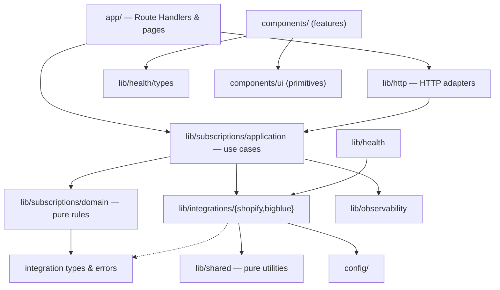

# Layers and dependency rules

The codebase follows a layered (ports-and-adapters flavoured) architecture.
Dependencies point inwards: outer layers know about inner ones, never the
other way round. Every rule on this page is enforced by
`no-restricted-imports` in [`eslint.config.mjs`](../../eslint.config.mjs);
violating one fails `pnpm lint`.

## Layer contracts

| Layer | Path | Responsibility | May import | Must not import |
| --- | --- | --- | --- | --- |
| **App** | `app/` | Next.js Route Handlers and pages. Translate HTTP ⇄ use cases. Route segment config (`runtime`, `maxDuration`, `dynamic`) stays as literal exports here because Next.js reads it statically. | everything below | — |
| **Feature components** | `components/{brand,layout,home,operations}/` | Domain-aware UI grouped by feature. | `components/*`, `config/site`, `@/lib/health/types` | `config/server-env`, any other `lib/` module, `app/` |
| **UI primitives** | `components/ui/` | Generic, domain-free building blocks (`StatusDot`, `HoverCard`). | other `components/ui/*` | `config/`, `lib/`, `app/`, feature components |
| **HTTP adapters** | `lib/http/` | Response envelopes, secret loading, bearer auth. | application, observability, shared | UI |
| **Application** | `lib/subscriptions/application/` | Use cases: orchestrate I/O, logging and error semantics. | domain, integrations, config, observability, shared | `lib/http`, `lib/health`, UI |
| **Domain** | `lib/subscriptions/domain/` | Pure business rules: detection, pricing, line planning. No I/O, no logging, no secrets. | integration *types/errors*, `config` (non-secret), shared | application, `config/server-env`, observability, integration clients and Admin readers, UI |
| **Integrations** | `lib/integrations/shopify/`, `lib/integrations/bigblue/` | Wire types, parsers, API clients and webhook verification for one vendor each. | config, observability, shared | each other, subscriptions, `lib/http`, `lib/health`, UI |
| **Health** | `lib/health/` | Connectivity probes for `/api/health`. | integrations, config, shared | subscriptions, `lib/http`, UI |
| **Observability** | `lib/observability/` | Structured log catalogue. | shared | config, every other `lib/` module, UI |
| **Config** | `config/` | Static configuration and the only reader of `process.env`. | config | `lib/`, UI |
| **Shared** | `lib/shared/` | Dependency-free utilities (guards, money, crypto, async, errors). | shared | everything else |

All imports use the `@/` alias; parent-relative imports (`../`) are banned
so that every dependency is visible to these rules.

## Why these boundaries

- **Domain purity** makes the money and idempotency rules testable with plain
  data and impossible to entangle with transport concerns. The domain cannot
  read secrets or log, so it cannot leak either.
- **One adapter per vendor** keeps Shopify and Bigblue swappable and stops
  vendor quirks from spreading. Cross-vendor logic lives in the application
  layer, where it is explicit.
- **Thin routes** keep HTTP status mapping, the only thing senders observe,
  in one obvious place per endpoint, pinned by route characterization tests.
- **Client isolation** guarantees by construction that no server module, and
  therefore no secret, can be bundled for the browser (in addition to the
  `server-only` guard on `config/server-env.ts`).

## Adding a module

1. Pick the innermost layer that can own it.
2. Add the MDS header (`@file`, `@module`) and JSDoc; run `pnpm docs:generate`.
3. Run `pnpm check`. If ESLint reports an architecture violation, move the
   code, invert the dependency (pass a function or data in), or, if the rule
   itself is wrong, change `eslint.config.mjs` **and** this page in the same
   change, with an ADR when the change is structural.
