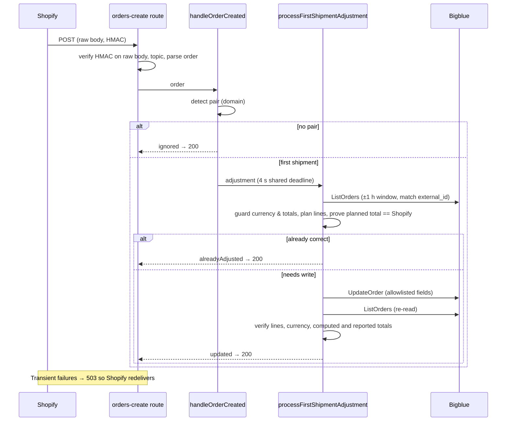

# Architecture overview

## Purpose

MISSENCE sells subscriptions whose **first shipment** includes an
"experience" product that physically contains one unit of the subscription
product. Shopify records both products; the warehouse (Bigblue) must ship
one fewer loose subscription unit per experience, and ship the experience as
its configured physical replacement SKU.

This service keeps Bigblue's **logistics copy** of each first-shipment order
in that target state, without ever changing the commercial record in Shopify.

## Non-negotiable properties

1. **Shopify is the source of truth.** Orders, subscription contracts,
   prices, discounts, payments and fulfillment orders in Shopify are never
   modified. Only the Bigblue copy is adjusted, and only before it leaves
   `PENDING` ([ADR-0001](../adr/0001-shopify-is-the-source-of-truth.md)).
2. **Exact money.** Bigblue's order total must equal Shopify's total to the
   cent, in the same currency, before *and* after every write. Otherwise
   nothing is written and the event is retried or escalated
   ([ADR-0003](../adr/0003-exact-money-verification.md)).
3. **Idempotency.** The target state is derived from Shopify only, never
   from Bigblue's current quantities, so any number of deliveries converges
   to the same state and a correct order is never rewritten
   ([ADR-0002](../adr/0002-target-state-derived-from-shopify.md)).
4. **Verify after write.** Success is declared only after re-reading the
   order from Bigblue.
5. **Defence in depth against lost events.** A webhook fast path is backed by
   event-driven and scheduled reconciliation
   ([ADR-0004](../adr/0004-reconciliation-safety-net.md)).

## System context

```mermaid
flowchart LR
  shopify[(Shopify)] -- "orders/create" --> create["/api/webhooks/shopify/orders-create"]
  shopify -- "orders/updated, orders/edited" --> events["/api/webhooks/shopify/order-events"]
  bigblue[(Bigblue)] -- "ORDER_STATUS_UPDATE" --> bbhook["/api/webhooks/bigblue/order-status"]
  cron[[External scheduler]] -- "Bearer secret, every ~5 min" --> recon["/api/cron/reconcile-bigblue"]
  create -- "ListOrders / UpdateOrder" --> bigblue
  events -- "Admin GraphQL read" --> shopify
  events --> bigblue
  bbhook -- "Admin GraphQL search" --> shopify
  bbhook --> bigblue
  recon --> shopify
  recon --> bigblue
  browser([Operator browser]) -- "/" and "/api/health" --> app[Operations page]
```

## Core business rule

For a configured pair (see
[`config/subscription-product-pairs.ts`](../../config/subscription-product-pairs.ts)):

```text
targetQuantity = max(subscriptionQuantity − experienceQuantity, 0)
```

- A first shipment is recognised by the **presence of both** the
  subscription and the experience product (SKU + product ID, plus variant ID
  when configured). A renewal contains only the subscription and is ignored.
- The experience line is rewritten to its explicit replacement SKU and
  receives its own value **plus** the value of the subscription units it
  absorbs. The loose subscription line keeps a prorated share. Total value is
  conserved.
- A target of `0` removes the subscription line; `quantity: 0` is never sent.

The rule lives in the pure domain layer:
[`first-shipment-adjustment.ts`](../../lib/subscriptions/domain/first-shipment-adjustment.ts),
[`line-pricing.ts`](../../lib/subscriptions/domain/line-pricing.ts) and
[`bigblue-line-item-plan.ts`](../../lib/subscriptions/domain/bigblue-line-item-plan.ts).

## Request flows

### 1. `orders/create` — fast path



Shopify requires an answer within five seconds; all Bigblue calls share a
four-second budget enforced by the client's `deadlineAtMs`.

### 2. `orders/updated` / `orders/edited` — event reconciliation

The payload only identifies the order. Its **current** state is re-read from
the Admin GraphQL API (`currentQuantity`, `currentTotalPriceSet`, prorated
discounts and taxes) and reconciled while Bigblue is `PENDING`. Cancelled or
already-fulfilled orders are skipped. An edited order that no longer
contains the pair is flagged with `manual_review_required`: there is no safe
automatic transformation.

### 3. Bigblue `ORDER_STATUS_UPDATE` and the cron — store-wide reconciliation

Both run [`runRecentBigblueReconciliation`](../../lib/subscriptions/application/run-reconciliation.ts):
search Shopify for orders of the last 48 hours containing any experience
SKU, then reconcile each one sequentially. The cron is **required** in
production; the Bigblue webhook is a complementary trigger because status
events are not documented to fire on line-item reverts.

## Failure semantics

| Condition | Response | Who retries |
| --- | --- | --- |
| Bigblue has not imported the order yet | `503` (webhook) / skipped (cron) | Shopify redelivery, next cron cycle |
| Bigblue `5xx`, `408`, `429`, timeout, network error | `503` | Sender |
| Bigblue `412` (no longer editable) | `409` | Nobody; investigate |
| Other Bigblue `4xx` | `502` | Nobody; investigate |
| Money/currency mismatch, write not persisted | `503` + `price_mismatch` / `update_not_persisted` | Sender; persistent cases need a human |
| Invalid signature / topic / shop / payload | `401` / `400` | Nobody |

## Module map

```text
app/api/…                         Route Handlers (thin HTTP adapters)
lib/http/                         Response envelopes, secret loading, bearer auth
lib/subscriptions/application/    Use cases: handle-order-created, handle-order-event,
                                  process-first-shipment, reconcile-first-shipments, run-reconciliation
lib/subscriptions/domain/         Pure rules: detection, line pricing, Bigblue line plan
lib/integrations/shopify/         Order model + parser, webhook HMAC, order events, Admin GraphQL reader
lib/integrations/bigblue/         RPC client, wire types, parsers, search, totals, update, webhook auth
lib/health/                       /api/health probes (cached, single-flight)
lib/observability/                Structured event catalogue
lib/shared/                       Guards, money, crypto, async, error helpers
config/                           Product pairs, feature flags, API settings, env access
scripts/                          Project CLI, Bigblue dry-run, webhook URL helper, docs engine
components/ui/                    Domain-free UI primitives
components/{brand,layout,home}/   Page building blocks
components/operations/            Integration status feature (client: hook + views)
tests/                            Mirrors the source tree (see engineering standards)
```

The [API reference](../reference/api.md) documents every exported symbol,
including the configured product pairs (`PRODUCT_PAIRS`).

## External references

- [Shopify: verify webhook deliveries](https://shopify.dev/docs/apps/build/webhooks/verify-deliveries)
- [Shopify: order webhooks](https://shopify.dev/docs/agents/orders/order-webhooks)
- [Bigblue Store API](https://bigblue.notion.site/Bigblue-Store-API-Documentation-4e9c3d052a1a4b73b59709edfe8b7457)
